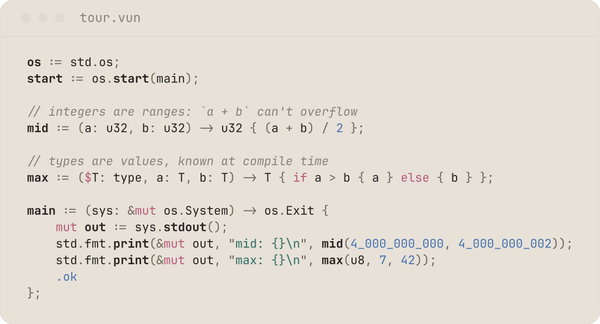

<p align="center">
  <picture>
    <source media="(prefers-color-scheme: dark)" srcset="assets/logo/wordmark/dark.svg">
    
  </picture>
</p>

<p align="center">A smol systems programming language.</p>

<p align="center">
  <picture>
    <source media="(prefers-color-scheme: dark)" srcset="assets/cards/code/dark.png">
    
  </picture>
</p>

Vun is for software that runs under constraints: firmware, kernels, runtimes, servers. It is
built on seven concepts, each with one rule; everything else is a library.

- **No overflow.** Integers are ranges, arithmetic widens, narrowing is always written.
- **No lifetime annotations.** A returned borrow is tied to every argument it borrows.
- **No hidden calls.** No destructors: cleanup is `defer`, and a value that must be consumed is
  checked on every path.
- **No macro language.** Code generation is ordinary compile-time Vun, typed and traceable.
- **No privileged code.** Primitives are declarations in `lang`; `std` has no power yours lacks.

> [!WARNING]
> Experimental and changing every day. Do not use it for anything that matters.

## Try it

With a recent Rust toolchain and a C compiler:

```sh
cargo run -q -p vun-cli -- run corpus/accept/programs/tour.vun
```

Programs build through C or a native backend (x86-64, arm64, Thumb-2) for Linux, or to
WebAssembly for WASI.

## Learn more

- [Whitepaper](whitepaper/main.typ): the design in one read.
- [Specification](docs/spec/00-principles.md) and [decisions](docs/spec/decisions.md).
- [Contributing](CONTRIBUTING.md).

## License

Dual-licensed under [MIT](LICENSE-MIT) or [Apache 2.0](LICENSE-APACHE), at your option.

The language design and its decisions are mine. Most of the code, the specification's prose and
the whitepaper were written by AI coding agents (Claude) under my direction.
