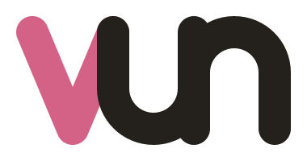
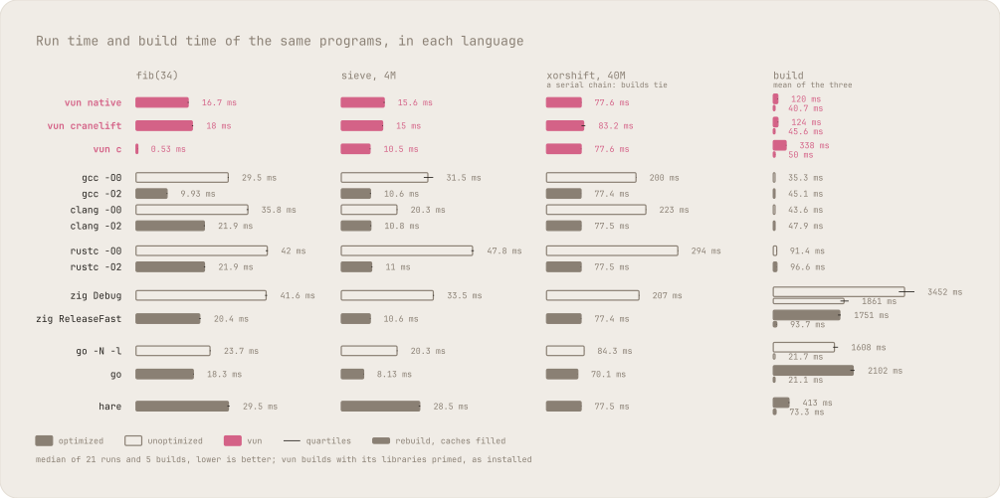

<p align="center">
  <picture>
    <source media="(prefers-color-scheme: dark)" srcset="assets/logo/wordmark/dark.svg">
    
  </picture>
</p>

<p align="center">a smol systems programming language :3</p>

<p align="center">
  <picture>
    <source media="(prefers-color-scheme: dark)" srcset="assets/cards/code/dark.png">
    
  </picture>
</p>

Vun is for thingies that run under constraints: firmware, kernels, runtimes, servers, or whatever you want!

> [!WARNING]
> **Experimental** - I am begging you please do not use it for anything that matters.

## Try it

With a recent (1.90+ maybe?) Rust toolchain and a C compiler:

```sh
cargo run -q -p vun-cli -- run corpus/accept/programs/tour.vun
```

## Performance

The same three programs written in each language, built by that language's compiler and timed on one machine.

<p align="center">
  <picture>
    <source media="(prefers-color-scheme: dark)" srcset="assets/cards/bench/dark.svg">
    
  </picture>
</p>

## Learn more

- [Whitepaper](whitepaper/main.typ): the design in one read.
- [Specification](docs/spec/00-principles.md) and [decisions](docs/spec/decisions/README.md).
- [Contributing](CONTRIBUTING.md).

## License

Licensed under the [DBAD](/LICENSES/DBAD.md) (Don't Be A Dick) or [QUACK](/LICENSES/QUACK.md) licenses, up to you.

## Disclaimer

For all my "duck AI" folks: this was **HEAVILY** built by relying on LLMs. All of the language's design, ergonomics, decisions blah blah blah were **mine**.

Even though I have reviewed **most** of the code, I do **NOT** guarantee anything about its quality or whatever.
